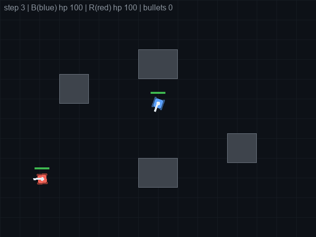
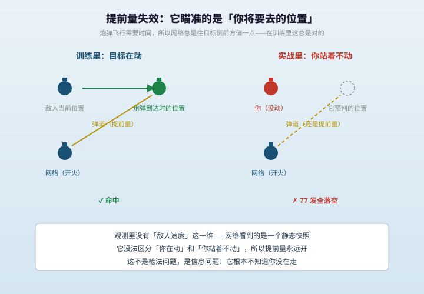
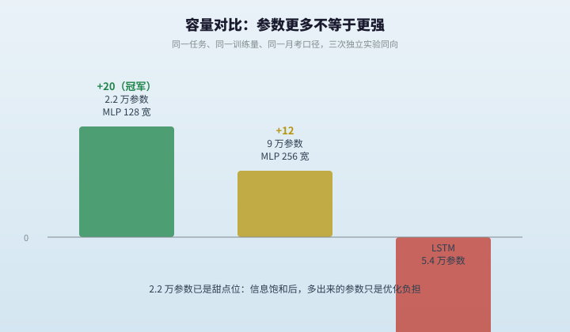

# Smart Tank · 手写 numpy 的坦克强化学习

一个 800×600 的坦克对战环境，加上一套**完全用 numpy 手写**的策略梯度训练栈：前向传播、反向传播、Adam、GAE、PPO、行为克隆拴绳，全部自己实现，不依赖 PyTorch / TensorFlow。

目标不是做一个游戏，而是用一件能看得见的小事，把「神经网络怎么被训练出来、又怎么被训练坏」这件事走一遍。



---

## 成绩

月考口径：对规则老师 30 局、对随机对手 30 局，
**score = 对老师净胜场 + 0.5 × 对随机净胜场**（净胜 = 胜 − 负，平局不计）。

| 版本 | 关键改动 | score |
|---|---|---|
| v8 | 行为克隆 + 早期 RL | +15 |
| v15 | 掩体可摧毁（3 HP） | +15 |
| v21 | BC 拴绳（λ=0.1） | +8 |
| v23 | 迁移学习 + 退火拴绳（λ 0.3→0.05） | **+20** |
| v25a | 随机掩体训练，考固定图 | +18（泛化） |
| v25b | 隐层加宽到 256 | +12 |
| LSTM v3 | 换带记忆的网络 | 零学习信号 |

---

## 快速开始

```bash
python3 -m venv .venv && . .venv/bin/activate
pip install -r requirements.txt

# 1) 人机对战：方向键转向/移动，空格开火，R 重开，Q 退出
python scripts/play_human.py --weights data/rl-v23.npz

# 2) 自动评测：打 30 局老师 + 30 局随机
python scripts/eval_bc.py --weights data/rl-v23.npz --games 30 --destructible

# 3) 录一段 GIF
python scripts/record_demo_gif.py --weights data/rl-v23.npz --seed 703 --out demo.gif
```

训练（可选，CPU 即可）：

```bash
# 行为克隆：先生成数据，再训练
python scripts/record_data.py --games 200 --out data/dataset-v1.npz
python scripts/train_bc.py --grad-check      # 先做数值梯度校验
python scripts/train_bc.py --train

# 强化学习：28 进程并行自对弈
python scripts/train_parallel.py --workers 28 --games 252 --iters 2000 \
  --destructible --vs-teacher --lr 3e-5 \
  --bc-lambda 0.05 --bc-data data/bc-v15-cover.npz \
  --init data/rl-v23.npz --out data/rl-my.npz
```

---

## 环境

- 场地 800×600，2 辆坦克，4 块轴对齐矩形掩体（可开启「3 点血可摧毁」）
- 动作 5 个：左转 / 右转 / 前进 / 后退 / 开火（转向 3.4°/步，前进 2.2 px/步，后退 1.4 px/步）
- 开火冷却 18 步；炮弹沿炮口方向直线飞行，撞掩体或命中即消失
- 观测 37 维（详见 `scripts/arena.py` 的 `observe()`）：
  - 自身：坐标、炮口朝向（两个余弦分量）、血量
  - 敌方：坐标、朝向、血量
  - 相对：dx、dy、距离
  - 最近的敌方炮弹：相对位置、速度
  - 自身冷却是否就绪、剩余时间、常数项
  - 4 块掩体：每块的中心位置与半宽半高（16 维）
  - 视线：敌我连线是否被掩体挡住（0/1）
- 观测里**没有**敌方速度、也没有敌方冷却——这不是疏忽，后文「实验结论」会讲它的后果

---

## 代码结构

| 脚本 | 作用 |
|---|---|
| `arena.py` | 游戏引擎：物理、观测、渲染、GIF 录制 |
| `rule_teacher.py` | 手写规则老师（接近 + 瞄准 + 调距 + 卡射线） |
| `bot_roster.py` | 六个流派的脚本对手：莽夫 / 狙击手 / 游击手 / 绕后 / 拆迁队长 / 老师 |
| `record_data.py` | 用规则老师录行为克隆数据集 |
| `train_bc.py` | 手写 MLP + 反向传播 + Adam + 数值梯度校验 |
| `train_rl.py` | REINFORCE / Actor-Critic / PPO(GAE) 单进程训练 |
| `train_parallel.py` | 多进程并行采样工厂（v23 用 28 工人） |
| `lstm_net.py` / `train_lstm*.py` | LSTM 版本（结论：负收益，留作对照） |
| `eval_bc.py` | 月考：对老师/随机/各流派批量对战，输出战绩与命中率 |
| `play_human.py` | 人机对战入口（键盘操控红方） |
| `analyze_circling.py` | 行为量化：贴墙率、绕柱净跨度、开火时机、特征使用率 |
| `record_demo_gif.py` | 录单局 GIF |

`notes/` 下是 20 篇设计笔记，按时间顺序记录了每个决定的原因和踩过的坑，包括失败的实验。

---

## 训练栈：从模仿到拴绳

这套代码走过的路线，基本是「怎么把一个会模仿的学生，教成一个能自对弈的选手，再拴住不让它跑偏」：

1. **行为克隆（BC）**：老师打 30 万步，监督学习 37→128→128→5，验证集 94%，训练 30 秒
2. **REINFORCE**：自对弈采样 + 回报归一化，命中奖励逐步调参
3. **Actor-Critic**：加价值头做基线，降低方差
4. **PPO + GAE**：信任域裁剪 + 优势估计，训练更稳
5. **对手池 / 六流派陪练**：防止「只会打自己」
6. **BC 拴绳 + 退火**：训练目标 = RL 回报 + λ × 与老师的 KL 距离；λ 从 0.3 退火到 0.05，永不为零

第 6 条是这套代码里最关键的发现：纯回报最大化会把策略锁进「少输」的局部最优（蹲坑、绕圈、不开火），加经验、换算法、换对手都只是**更快地到达**那个坑；只有行为先验锚定能把它拉出来。这也是 AlphaStar 用的同一套配方，只是这里跑在 2.2 万参数的小网络上。

---

## 实验结论（都可复现）

**1. 容量不是越大越好。** 128 宽（2.2 万参数）+20，256 宽（9 万参数）+12，LSTM（5.4 万参数）零学习信号。任务信息已饱和，多余参数只增加优化难度。

**2. 泛化成立。** 只在随机掩体布局上训练，考一张从未见过的固定地图，仍得 +18，与固定图训练的冠军 +20 统计等价——学到的是「利用掩体、控制距离」这类原理级技能，不是背地图。

**3. 对分布外输入会静默崩溃。** 训练里所有对手都在动；把人操控的坦克停住不动，冠军**开了 77 炮，一发没中**。原因：观测里没有敌方速度，它学到的「提前量」是对移动目标的统计偏置。



**4. 「绕柱」这个战术不存在。** 补上敌方速度与冷却后重训（37→40 维，两炉共 2000 轮），绕柱事件仍是 0；把掩体奖励加 5 倍，还是 0。用净角度跨度（而非角度绝对值累加）测量，规则老师自己跟自己打也只有 5°。老师和神经网络是两种活法：老师贴墙蹲守（79.5% 的步数贴墙、94% 时间视线被挡），网络拉开距离对射（贴墙 2%~5%）。



---

## 数据说明

仓库只带 4 个小权重（每个约 175 KB）和 3 份训练日志，用于直接跑推理与复现月考。

**没有入库**的大文件（行为克隆数据集约 37–39 MB、各类 `-resume.npz`）可以用脚本重新生成：

```bash
python scripts/record_data.py --games 200 --out data/dataset-v1.npz
```

---

## 已知局限

- 观测是手工设计的 37 维，不含敌方速度/冷却，因此无法做提前量式的预判，也做不出针对移动的时机决策
- 动作离散（每步转向 3.4°），做不出平滑的绕行轨迹
- 月考方差较大（同一权重不同种子可差 ±3 分），文中分数均为多种子平均或多局统计
- 未做系统性超参搜索；结论都限定在「这个任务、这个观测、这个奖励」下

---

## 许可

MIT，见 `LICENSE`。
